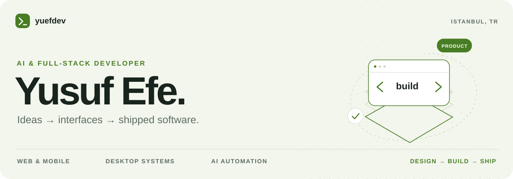
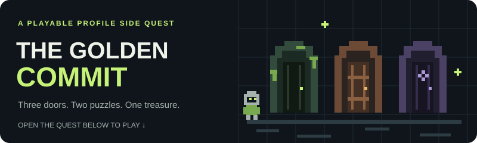

<picture>
  <source media="(max-width: 600px) and (prefers-color-scheme: dark)" srcset="./assets/hero-dark-mobile.svg">
  <source media="(max-width: 600px)" srcset="./assets/hero-light-mobile.svg">
  <source media="(prefers-color-scheme: dark)" srcset="./assets/hero-dark.svg">
  
</picture>

[English](./README.md) · [E-posta](mailto:ergyusuf34@gmail.com) · [LinkedIn](https://www.linkedin.com/in/yusuf-efe-ergino%C4%9Flu-b14512336/)

  
  
  

  

## Merhaba, ben Yusuf.

İstanbul'da yaşayan; **yapay zekâ araçları, web ve mobil uygulamalar, masaüstü yazılımları** geliştiren bir yazılımcıyım. Bir ürünün arayüzünü, arkasındaki API'yi ve günlük işlerini kolaylaştıran otomasyonları birlikte ele alıyorum.

**Otomasyon, e-ticaret ve teknik servis** geçmişim sayesinde önce gerçek ihtiyacı anlamaya, ardından kullanımı kolay bir çözüm üretmeye odaklanıyorum. Arayüz ayrıntıları, performans ve sürdürülebilir mimari benim için önemli.

**İlgilendiğim roller:** Yapay zekâ uygulama geliştirme, full-stack yazılım geliştirme ve masaüstü ürün geliştirme.

## Açık kaynak katkılarım

**Son 12 ayda bana ait olmayan 53 depoda 105 PR'ım birleştirildi.** Sayılar **19 Ekim 2026** tarihinde GitHub verilerinden doğrulandı.

- **Python araçları:** [Pylint](https://github.com/pylint-dev/pylint/pull/11546), [SQLFluff](https://github.com/sqlfluff/sqlfluff/pull/8638) ve [LiteLLM](https://github.com/BerriAI/litellm/pull/41677) hata düzeltmeleri.
- **Rust ve model çalıştırma:** [uutils/coreutils](https://github.com/uutils/coreutils/pull/14565), [Candle](https://github.com/huggingface/candle/pull/3975) ve [tract](https://github.com/sonos/tract/pull/2849) düzeltmeleri.
- **Günlük kullanılan araçlar:** [Pydash](https://github.com/dgilland/pydash/pull/321) ve [New-Tab](https://github.com/404-PF/New-Tab/pull/849) düzeltmeleri.

[Katkı ayrıntıları ve doğrulama](./OPEN_SOURCE.md)

## Öne çıkan çalışmalarım

- **[Riftroam](https://github.com/yuefdev/riftroam-releases/releases)** — League of Legends için Tauri, Svelte ve Rust ile geliştirilen masaüstü yardımcı uygulaması. İstemci entegrasyonu, özelleştirme akışları ve uygulama içi güncelleme deneyimi üzerinde çalışıyorum. Bağlantı herkese açık sürüm deposuna gider; uygulamanın kaynak kodu bu depoda paylaşılmıyor.
- **[DerdiniSeveyim](https://github.com/yuefdev/DerdiniSeveyim)** — Expo/React Native mobil uygulaması, Next.js web sitesi ve yönetim paneli, NestJS API'si, kimlik doğrulama ve gerçek zamanlı mesajlaşmayı birleştiren TypeScript monoreposu.
- **[Windows FPS Utility](https://github.com/yuefdev/unlostfpsarttirma)** — Windows güç, görsel efekt ve oyun ayarlarını tek arayüzde toplayan C# / WPF uygulaması. Ayarları geri alma adımları belgelenmiştir.
- **[Harborlights](https://github.com/yuefdev/HarborRestaurant)** — Hazır bir HTML temasını ASP.NET Core MVC ile rezervasyon, içerik yönetimi ve yönetim paneli bulunan dinamik bir uygulamaya dönüştürdüğüm eğitim projesi.

**Yapay zekâ araçları:** [YuefIDE](https://github.com/yuefdev/yuefide), prompt oluşturma ve kod yardımı odaklı geliştirme ortamı projem. Herkese açık deposunda şu anda proje tanıtımı bulunuyor.

## Yan görev · Altın commit

Buradan ayrılmadan oynayabileceğin küçük bir zindan. İki bulmaca, bir hazine. Başlamak için bir kapı seç.

<b>▶ Maceraya başla</b>

### Oda 1 · Üç kapı

Altın commit, bu kapılardan birinin ardındaki kasada saklı. **Tabelalardan yalnızca biri doğru söylüyor.**

- **Yosunlu kapı:** “Hazine bu kapının arkasında.”
- **Bakır kapı:** “Hazine bu kapının arkasında değil.”
- **Mor kapı:** “Hazine yosunlu kapının arkasında değil.”

🌿 Yosunlu kapıyı aç

**👾 Bir balçık canavarı çıktı!**

Senden kod incelemesi istiyor. Bu iş uzayacak. Kapıyı kapatıp başka bir yol dene.

🔶 Bakır kapıyı aç

**🗝️ Kasanın anahtarını buldun.**

Doğru söyleyen tek tabela mor kapıdaydı. Güzel çözdün.

### Oda 2 · Ayna kilidi

Üç sandık var ama anahtarın yalnızca birini açıyor. Notta şöyle yazıyor:

> Hem baştan hem sondan okunduğunda aynı kalan işareti seç.

📦 Sandık 100

**🦷 Bu sandık kılık değiştirmiş bir canavar.** Anahtarını yemeye çalışıyor. Kapatıp notu tekrar oku.

📦 Sandık 101

**🏆 Altın commit bulundu!**

İki bulmaca çözüldü, sıfır merge conflict. Oynadığın için teşekkürler.

📦 Sandık 110

**🚨 Alarm çaldı.** Uykulu bir ejderha ertele tuşuna bastı. Sandığı kapatıp tekrar dene.

🔮 Mor kapıyı aç

**🕸️ 404: hazine bulunamadı.**

Sadece örümcek ağları ve 2019'dan kalma bir TODO var. Kapıyı kapatıp başka bir yol dene.

Açmak için seçeneğe tıkla veya dokun; geri dönmek için kapat. Seçimlerin bu sayfada kalır. Yeniden oynamak için açtığın kapıları ve sandıkları kapat.

## Kullandığım teknolojiler

| Alan | Teknolojiler |
| :--- | :--- |
| Arayüz | TypeScript, React, Next.js, Svelte, Tailwind CSS |
| Mobil ve masaüstü | React Native / Expo, Tauri, Rust, C# / WPF |
| API ve veri | Node.js, NestJS, ASP.NET Core, PostgreSQL, Prisma, Redis |
| Yapay zekâ ve dağıtım | Python, OpenAI API, LangChain, Docker, GitHub Actions |

## GitHub grafikleri

<picture>
  <source media="(max-width: 600px) and (prefers-color-scheme: dark)" srcset="https://raw.githubusercontent.com/yuefdev/yuefdev/main/assets/generated/github-dark-mobile.svg?v=70be311">
  <source media="(max-width: 600px)" srcset="https://raw.githubusercontent.com/yuefdev/yuefdev/main/assets/generated/github-light-mobile.svg?v=70be311">
  <source media="(prefers-color-scheme: dark)" srcset="https://raw.githubusercontent.com/yuefdev/yuefdev/main/assets/generated/github-dark.svg?v=70be311">
  
</picture>

Grafik herkese açık GitHub verilerinden üretildi; veri tarihi grafiğin üzerinde gösterilir. Katkılar profilin herkese açık takviminden alınır ve içinde bulunulan ay henüz tamamlanmamıştır. Dil dağılımı, bana ait herkese açık depoların kod baytlarını gösterir; fork'lar dahil değildir. Yetenek puanı veya çalışma süresi ölçümü değildir.

## Birlikte çalışalım.

**İş fırsatları ve proje iş birlikleri** için geliştirdiğiniz ürünü ve hangi alanda katkı aradığınızı yazabilirsiniz.

**[ergyusuf34@gmail.com](mailto:ergyusuf34@gmail.com)** · **[LinkedIn](https://www.linkedin.com/in/yusuf-efe-ergino%C4%9Flu-b14512336/)**
